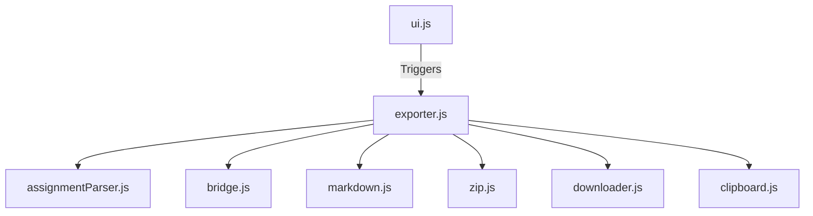

# Assignment Export Feature

## Motivation
Students often want to save their assignment problem statements, MCQs, and their written code for offline review, interview preparation, or archiving. Manually copy-pasting code and problem statements from multiple pages is tedious.

## User Workflow
1. A student navigates to any coding or MCQ assignment page on the Scaler platform.
2. They click the "Export" button injected into the header next to the problem title.
3. They select one of four options:
   - **Export This Problem**: Instantly downloads the active problem as a Markdown file.
   - **Export All (ZIP)**: Triggers a background process that silently iterates through all problems in the assignment sidebar, zipping them into a single archive before prompting a download.
   - **Copy This Problem**: Puts a rendered preview of the active problem on the clipboard — ready to paste into a doc, email, or an LLM chat — instead of downloading a file.
   - **Copy All**: Collects every problem in the sidebar (same discovery/scraping pipeline as Export All), then arms the button into a "Click to copy N problems" state; the next click copies a single combined document to the clipboard. See [Copy Pipeline](#copy-pipeline) for why this is two clicks instead of one.

## UI Overview
- The UI consists of a non-intrusive, styled "Export" button with a dropdown (`ui.js`).
- The button provides visual feedback during long-running bulk exports (e.g., displaying "Exporting 3/10..." / "Collecting 3/10..." and disabling interactions).
- Upon completion, the button transitions to a green "✓ Downloaded"/"✓ Copied!" state for 1.5 seconds.
- Between collection and confirmation, Copy All shows a distinct blue clipboard icon with a "Click to copy N problems" tooltip; if left unclicked for 60 seconds it silently reverts to the idle "Export" state.
- The UI handles focus rings for keyboard accessibility and closes automatically upon clicking outside.

## Architecture Overview
The feature is heavily decoupled, using a strict one-way data flow orchestrator pipeline.



## Component Responsibilities
- `content/utils/assignmentParser.js`: Generic DOM scraper for Scaler assignments. Reused by `leetcodeLink.js`.
- `content/features/assignmentExport/assignmentExport.js`: Entry point. Polls the DOM and checks extension settings.
- `content/features/assignmentExport/ui.js`: Injects the Export button and handles UI state, including the Copy All "ready to copy" state.
- `content/features/assignmentExport/exporter.js`: The orchestrator. Fetches URLs, manages hidden iframes, and pipes data through the layers.
- `content/features/assignmentExport/bridge.js`: Injects `pageBridge.js` and listens for custom events.
- `content/features/assignmentExport/pageBridge.js`: Executes in the page context to access `window.monaco`.
- `content/features/assignmentExport/markdown.js`: Serializes a problem's scraped fields into Markdown (`generateMarkdown`), rendered HTML (`generateHtml`), and symbol-free plain text (`generatePlainText`); also joins multiple problems into one combined document for Copy All (`joinProblemsHtml`/`joinProblemsPlainText`).
- `content/features/assignmentExport/zip.js`: A thin wrapper around JSZip for Blob generation.
- `content/features/assignmentExport/downloader.js`: Handles Blob URL generation and `<a download>` triggering.
- `content/features/assignmentExport/clipboard.js`: `copyRich(html, plainText)` — writes a rendered preview to the clipboard, with an `execCommand` fallback chain. No `clipboardWrite` permission required.

## Export Pipeline
1. **User clicks Export**: `ui.js` triggers `exporter.js` and locks the UI.
2. **Parser**: `assignmentParser.js` extracts Title, Session, Question Type, Statement, and MCQ options.
3. **Bridge**: `bridge.js` extracts the user's code from the Monaco editor.
4. **Markdown**: `markdown.js` formats the parsed fields into a `.md` string, complete with a metadata header.
5. **ZIP (Bulk only)**: `zip.js` stores the `.md` string in a structured JSZip archive.
6. **Download**: `downloader.js` converts the string/archive to a Blob and downloads it.

## Copy Pipeline
Copy reuses every scraping step of the Export pipeline (`buildCurrentProblemFields()` for a single
problem, `discoverProblemLinks()` + `collectAllProblemFields()` for all of them) so the two features
can never drift apart on *what* gets extracted — only on what happens to it afterwards. Both paths
build a plain `fields` object first, and Export/Copy each pick their own renderer off it:
`generateMarkdown(fields)` for Export, `generateHtml(fields)` + a plain-text companion for Copy.

1. **User clicks Copy This Problem / Copy All**: `ui.js` triggers `exporter.js` via the same
   `handleExport()` guard as Export, sharing the `isExporting` lock.
2. **Scrape**: identical to Export — `buildCurrentProblemFields()` (single) or
   `discoverProblemLinks()` + `collectAllProblemFields()` (all).
3. **Render**: `generateHtml(fields)` builds an HTML fragment structurally identical to the Markdown
   (same field order, same fallback strings), with every scraped value passed through `escapeHtml()`
   before insertion — never raw. `generatePlainText(fields)` builds a symbol-free plain-text
   rendering (no `#`, `**`, or code fences) for paste targets that only read `text/plain`.
4. **Combine (Copy All only)**: `joinProblemsHtml()`/`joinProblemsPlainText()` concatenate every
   problem's rendering in index order, with a header (`"{Session}"` / `"N problems exported by
   Scaler++"`) and a divider between problems — `<hr>` + a grey "Problem i of n" label in the HTML.
   The plain-text divider depends on `COPY_PLAIN_TEXT_FORMAT`: in `"markdown"` mode it's
   `<!-- ========== Problem i of n ========== -->` (an HTML comment, chosen so it can't be confused
   with the `---` a single problem's own Markdown rendering may contain); in the default
   `"rendered"` mode it's a plain `========== Problem i of n ==========` line instead — an HTML
   comment would itself be a stray markup symbol in an otherwise symbol-free plain-text rendering.
5. **Copy All's two-step, focus-safe design**: collecting every problem can take many seconds, but
   `navigator.clipboard` requires the document to be focused *and* the write to happen inside (or
   very shortly after) a user gesture. An `await`-heavy collection loop can easily outlive that
   gesture. So `copyAllAssignments()` does **not** write to the clipboard itself — once collection
   finishes, it calls `setCopyAllReady()` (`ui.js`) to arm the button into a "Click to copy N
   problems" state (distinct blue icon) and stores the combined HTML/text for later. The *next*
   click on the main icon — a fresh, synchronous gesture — is what actually calls `copyRich()`. If
   nothing is clicked within 60 seconds, the ready state silently clears itself and releases the
   underlying `isExporting` lock; the same cancellation path also runs on feature toggle-off and on
   re-injection (SPA navigation to a new problem page), so the lock can never get stuck. If collection
   itself finishes *after* the user has already navigated away — the button wrapper captured before
   collection started is no longer connected to the page — the ready state is never armed at all: the
   bulk-animation interval is stopped, the *new* page's button (if any) briefly shows "Copy cancelled
   (page changed)" for feedback, and the lock releases immediately, rather than leaving the collecting
   animation running forever on a button collection never actually finished for.
6. **Write**: `copyRich(html, plainText)` (`clipboard.js`) tries `navigator.clipboard.write()` with
   a `ClipboardItem` carrying both `text/html` and `text/plain` slots first; if that's unavailable or
   rejects, it falls back to selecting a hidden `contenteditable` element's contents and
   `document.execCommand("copy")`; if that also fails, it falls back to
   `navigator.clipboard.writeText(plainText)`. It never throws, and never requires the
   `clipboardWrite` permission (both APIs work from a content script without it when used from a
   user gesture on a focused, visible document).
7. **`COPY_PLAIN_TEXT_FORMAT`** (`clipboard.js`): a single constant controlling what fills the
   clipboard's `text/plain` slot — `"rendered"` (default, `generatePlainText()`'s clean prose) or
   `"markdown"` (`generateMarkdown()`'s source). Rich editors (Google Docs, Notion, Gmail) read the
   `text/html` slot either way, so this only matters for plain-text-only paste targets — and many
   LLM chat inputs fall into that bucket, reading `text/plain` even when a page also offers
   `text/html`.

## Parser Design
`assignmentParser.js` is designed to be fully generic. Every function accepts an optional `doc = document` parameter. This allows the parser to scrape data from both the active user-facing DOM and from isolated `iframe.contentDocument` contexts during bulk exports, maximizing code reuse.

## Bridge Communication
Chrome Extensions run content scripts in an "Isolated World". They can see the page's DOM, but cannot see the page's JavaScript variables (like `window.monaco`). 
`pageBridge.js` is injected directly into the DOM (`<script>`) so it runs in the "Main World". It reads `window.monaco` and uses `window.dispatchEvent(new CustomEvent(...))` to send the code back to the isolated `bridge.js`.

## Hidden Iframe Approach
To perform a "Bulk Export" of an entire assignment without redirecting the user, `exporter.js` creates an invisible `<iframe>`. 
- **Why?** Scaler is a Single Page Application (SPA). The backend API is heavily authenticated and complex to reverse-engineer. Loading the page in an iframe allows us to reuse the existing React SPA logic and our existing DOM parsers.
- **Trade-offs:** It is slightly slower (sequential page loads) and requires robust timeout handling in case the React SPA hangs.
- **Alternatives considered:** Fetching raw HTML (failed because code is rendered via JS), or reverse-engineering the GraphQL/REST API (brittle to upstream changes).

## Markdown Format
Formatted with GitHub-flavored markdown.
- Starts with an H1 problem title.
- Followed by a metadata block (Session, Question Number, Question Type, Date).
- Code is fenced in ` ` ` ` blocks. 
- MCQs use checkbox syntax (`- [ ] **A)** Option`). Code fences are omitted if the question is an MCQ.

## ZIP Structure
Bulk exports group all files inside a top-level directory named after the Session Title. Filenames are padded for proper OS sorting.
```text
Concurrency 4 - Locks and Thread-Safe Programming/
    01 - Synchronization using Semaphores - 1.md
    02 - Synchronization using Semaphores - 2.md
```

## Error Handling
- **Concurrency Locks**: `isExporting` flag prevents users from triggering parallel bulk exports.
- **Iframe Sandboxing**: Every iframe iteration is wrapped in a `Promise.race` timeout (10s) and a `try/catch`. If an iframe crashes due to CORS redirects or SPA failures, it is cleanly caught and the exporter proceeds to the next problem.
- **Memory Leaks**: The bulk export is wrapped in a strict `try...finally` block that guarantees the invisible iframe is purged from the DOM even if a fatal exception occurs.

## Testing Strategy
- **Unit Tests**: Pure functions in `markdown.js` — `generateMarkdown`, `generateHtml`,
  `generatePlainText`, `joinProblemsHtml`, `joinProblemsPlainText` — are tested via Node's native
  test runner (`node:test`) in `tests/assignmentExportMarkdown.test.js` and
  `tests/assignmentExportCopy.test.js`, the latter also covering HTML-escaping of scraped values and
  the Copy All join's ordering/divider/header format.
- **Parser Tests**: `assignmentParser.js` logic is validated by feeding mocked HTML strings into `JSDOM` environments.
- **Testing Constraints**: Browser-dependent DOM manipulation inside `exporter.js`, `ui.js`, and
  `clipboard.js` (all three touch `document`/`navigator.clipboard`/iframes) is validated via manual
  QA, not unit tests.

## Known Limitations
- If Scaler changes their DOM class names, `assignmentParser.js` may need updates.
- If the user's internet drops while exporting, the iframe will time out after 10 seconds per problem and export empty files (Export) or omit that problem (Copy).
- Copy All's "ready to copy" window is 60 seconds; if the user switches tabs, gets distracted, and comes back after that, the state has silently reverted and they need to click Copy All again. This is a deliberate tradeoff for clipboard-permission safety, not a bug.
- `copyRich()`'s `execCommand("copy")` fallback (used when `navigator.clipboard.write` is unavailable or rejects) relies on a deprecated browser API; it's kept only as a safety net for older/atypical environments and may itself be removed by browsers eventually.

## Future Improvements
- Add a visual progress bar instead of updating the button text.
- Add support for exporting hints or solution approaches.
- Support parallel scraping (e.g. 2-3 iframes at once) for large assignments.
- Follow-ups identified but deliberately not addressed alongside the Copy feature (to keep that diff focused): the `[data-assignment-export-injected] > div:nth-child(2)` selector used to close other open dropdowns (pre-existing, appears to target the wrong child position), the `document`-level click listener registered once per button instance with no matching removal, and the three near-duplicate filename-sanitization blocks in `exporter.js`.
